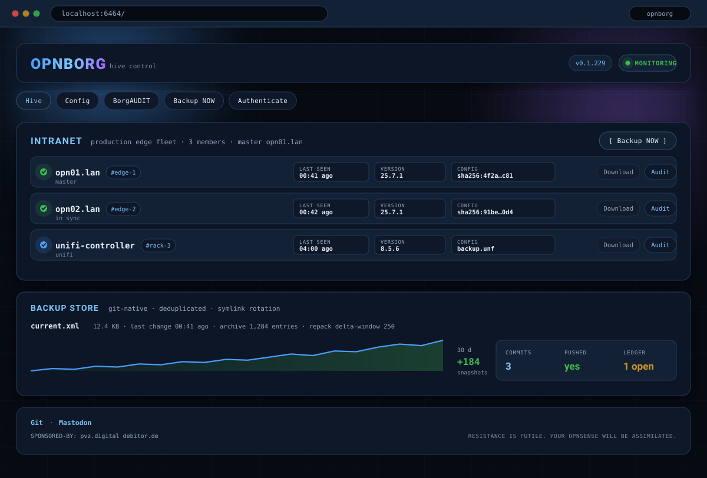
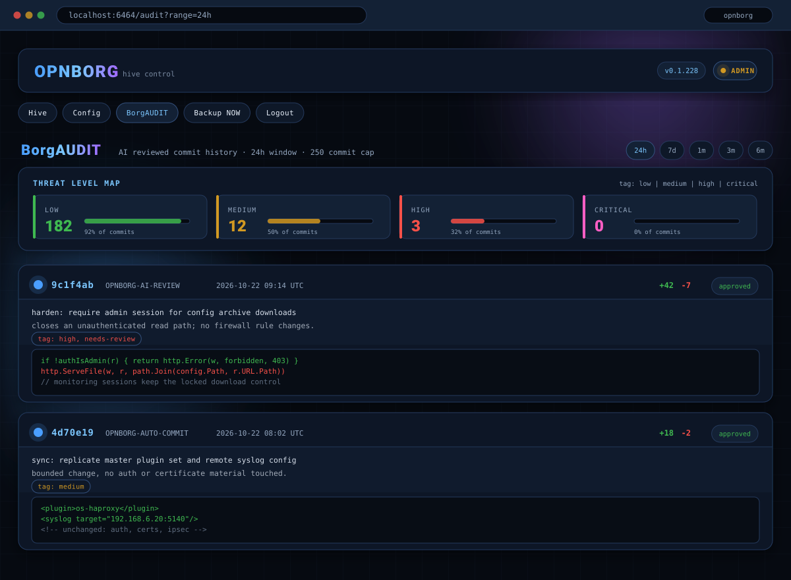
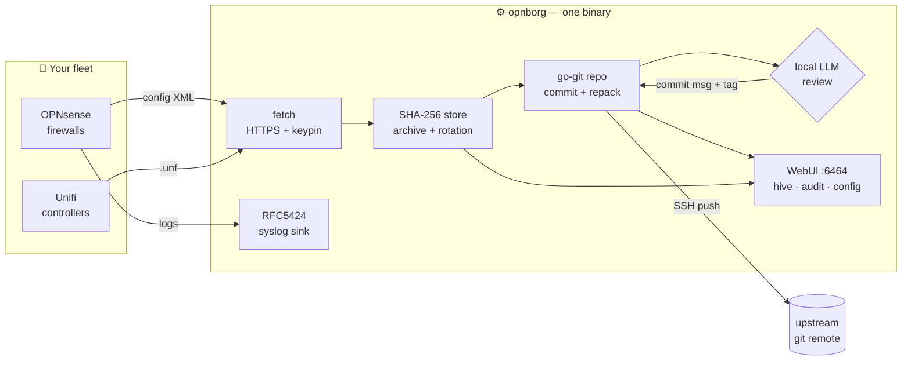

<div align="center">

<picture>
  <source media="(prefers-color-scheme: dark)" srcset="docs/hero-dark.svg">
  <source media="(prefers-color-scheme: light)" srcset="docs/hero-light.svg">
  
</picture>

### Resistance is futile. Your OPNsense will be assimilated. 🖖

**One binary. Your entire firewall fleet. Backed up, watched, audited, and under version control.**

A single self-hosted Go daemon that keeps every OPNsense firewall (and optionally every Unifi
controller) in a git-tracked, SHA-256 deduplicated archive — then lets a local LLM write the
security review of every change it makes.

[](https://pkg.go.dev/paepcke.de/opnborg)
[](https://goreportcard.com/report/paepcke.de/opnborg)
[](https://github.com/paepckehh/opnborg/releases/latest)
[](https://github.com/paepckehh/opnborg/blob/master/LICENSE)
[](https://search.nixos.org/packages?channel=unstable&from=0&size=50&sort=relevance&type=packages&query=opnborg)
[](#-quick-start)
[](#-quick-start)

[🚀 Quick Start](#-quick-start) · [✨ Features](#-features) · [📸 Screenshots](#-screenshots) · [🧠 How It Works](#-how-it-works) · [🔧 Configuration](#-configuration) · [🔐 Security](#-security-model) · [❓ FAQ](#-faq)

</div>

---

> [!TIP]
> **30-second demo** — point it at one firewall, get a WebUI on `:6464`, a deduplicated archive,
> and a git repo with AI-reviewed commit messages. No agents on the firewalls. No database server.
> No runtime dependencies.
>
> ```sh
> OPN_TARGETS='opn01.lan:8443' OPN_APIKEY='...' OPN_APISECRET='...' \
>   go run paepcke.de/opnborg/cmd/opnborg@main
> # ▸ WebUI live at http://localhost:6464
> ```

---

## ✨ Features

| | Feature | What it actually does |
| --- | --- | --- |
| 🖥️ | **Hive dashboard** | Live version, reachability and backup state per firewall, rendered as animated SVG by an embedded HTTP server — no JS framework, no build step. |
| 💾 | **Smart backups** | Every pass is SHA-256 hashed; unchanged configs are skipped, changed ones land in a timestamped `.archive/` with `CONFIG-CURRENT` / `CONFIG-LAST` rotation. |
| 🔁 | **Fleet sync** | Pick a master host — its plugin set and remote-syslog client config are replicated to every other target, so the hive never drifts. |
| 🤖 | **AI security audit** | A local LLM (Ollama, or any OpenAI-compatible endpoint) reads an enriched diff and writes the commit message: headline, security summary, and a `tag: low\|medium\|high\|critical` line. |
| 🧟 | **BorgAUDIT** | Commit-history review page: full diffs, a threat-level map, the admin who performed each change, and a per-commit approval ledger. |
| 🎛️ | **Unifi aware** | `.unf` backups, autoBackup folder watch, and inventory export (CSV/JSON) from the same binary, on the same dashboard. |
| 📜 | **Syslog collector** | Built-in RFC5424 server with rotated retention — point your firewalls at it, read it from the WebUI host. |
| 🔐 | **Two-mode WebUI** | Monitoring is always read-only and open; sensitive actions unlock per browser session behind Argon2id credentials. |
| ☁️ | **Git native** | go-git manages the storage repo: commit per backup pass, aggressive repack, SSH upstream push with host-key pinning. No git binary required. |
| 📦 | **One static binary** | `CGO_ENABLED=0`, embedded assets, zero runtime deps. Linux, BSD, macOS, Windows on amd64/arm64/armv7. |

---

## 📸 Screenshots

> All previews below are theme-aware — they follow your GitHub light/dark setting.

<details open>
<summary><b>🖥️ The hive — fleet status at a glance</b></summary>
<br>

<picture>
  <source media="(prefers-color-scheme: dark)" srcset="docs/screenshot-hive-dark.svg">
  <source media="(prefers-color-scheme: light)" srcset="docs/screenshot-hive-light.svg">
  
</picture>

Every member tile carries its version, last-seen time, config hash and asset tag.
Downloads are locked until you authenticate — by design.
</details>

<details open>
<summary><b>🧟 BorgAUDIT — the AI-reviewed change history</b></summary>
<br>

<picture>
  <source media="(prefers-color-scheme: dark)" srcset="docs/screenshot-audit-dark.svg">
  <source media="(prefers-color-scheme: light)" srcset="docs/screenshot-audit-light.svg">
  
</picture>

Each commit is a collapsible card: hash, author, diff stats, the model-written summary,
the severity tag, the full unified diff, and the admin account that made the change.
</details>

<details open>
<summary><b>⚡ Live backup console — force a pass and watch it stream</b></summary>
<br>

<picture>
  <source media="(prefers-color-scheme: dark)" srcset="docs/screenshot-backup-dark.svg">
  <source media="(prefers-color-scheme: light)" srcset="docs/screenshot-backup-light.svg">
  
</picture>

`/force` arms a pass; the progress page streams the daemon log line by line and redirects
back to the hive view when the pass completes.
</details>

---

## 🧠 How It Works



1. **Pull** — the daemon polls each target over HTTPS (OS trust store intentionally bypassed,
   `OPN_TLSKEYPIN` used for MitM-proofing) and fetches the live config.
2. **Diff & dedup** — a SHA-256 of the payload is compared with the previous `CONFIG-CURRENT`.
   No change, no write. Change, and the XML is archived and the symlinks rotate.
3. **Commit** — the storage directory is a git repo. Each pass stages the changed files, skips
   the approval ledger via a hardwired path guard, and commits.
4. **Review** — if a model is configured, an enriched diff (file metadata, widened hunks,
   detected XML sections) is sent to Ollama or an OpenAI-compatible endpoint. The model's answer
   *is* the commit message, including a `tag:` severity line.
5. **Surface** — the WebUI renders the hive, the audit history, and the approval ledger.

---

## 🚀 Quick Start

### Run from source (no build step)

```sh
OPN_PATH='/tmp/opn' \
OPN_TARGETS='opn01.lan:8443,opn02.lan:8443' \
OPN_APIKEY='...' \
OPN_APISECRET='...' \
go run paepcke.de/opnborg/cmd/opnborg@main
```

Prebuilt binaries: **[Releases](https://github.com/paepckehh/opnborg/releases)** ·
`go install paepcke.de/opnborg/cmd/opnborg@main`
Add `OPN_NODAEMON=1` for a single pass instead of the daemon.

<details>
<summary><b>🐳 Docker / Docker Compose</b> — distroless, <code>linux/amd64</code> + <code>linux/arm64</code></summary>

Published from every `v*` tag to [ghcr.io/paepckehh/opnborg](https://github.com/paepckehh/opnborg/pkgs/container/opnborg) — tags: `latest`, `edge`, `v0`, `v0.1`, exact release.

```yaml
services:
  opnborg:
    image: ghcr.io/paepckehh/opnborg:latest
    restart: unless-stopped
    ports: ["6464:6464"]
    volumes: [opnborg-data:/var/opnborg]
    environment:
      OPN_TARGETS: "opn01.lan:443,opn02.lan:443"
      OPN_APIKEY: "+RIb6YWNdcDWMMM7W5ZY..."
      OPN_APISECRET: "8VbjM3HKKqQW2ozO..."

volumes:
  opnborg-data:
```

> [!WARNING]
> Expose `6464` to trusted networks only — and arm `OPN_AUTH_HASH` / `OPN_AUTH_SALT` to unlock admin mode.

</details>

<details>
<summary><b>❄️ NixOS / Nix</b></summary>

Available as a [Nix package](https://search.nixos.org/packages?channel=unstable&from=0&size=50&sort=relevance&type=packages&query=opnborg). Ready-made modules in this repo:

`opnborg-docker.nix` · `opnborg-docker-complex.nix` · `opnborg-prometheus-grafana.nix` (Prometheus + Grafana; Wazuh/Influx/Graylog WIP)

</details>

---

## 🔧 Configuration

Everything is **environment variables** — the binary accepts only `-v` / `-h`. A local `.env`
file is auto-loaded. Ready-to-use examples live in the repo: `example.sh`,
`example-env-config-simple.sh`, `example-env-config-complex.sh`, `example-env-config-unifi.sh`,
`example-env-config-dev.sh`.

> [!IMPORTANT]
> **Booleans are presence-based.** `OPN_DEBUG=0` and `OPN_DEBUG=false` are both **true** —
> unset the variable to disable a feature. `OPN_GIT_ENABLE` is opt-in.

<details open>
<summary><b>🎯 Basics</b></summary>

| Variable | Default | Description |
| --- | --- | --- |
| `OPN_APIKEY` / `OPN_APISECRET` | — | OPNsense backup user API credentials *(required)* |
| `OPN_TARGETS` | — | Comma-separated targets, optional `#<asset-tag>` (`opn01.lan:8443#RACK-PROD01`) |
| `OPN_TARGETS_<GROUP>` | — | Named groups: `OPN_TARGETS_INTRANET='opn01.lan:8443,...'` |
| `OPN_TARGETS_DESC_<GROUP>` | — | WebUI group description |
| `OPN_TARGETS_IMGURL_<GROUP>` | — | WebUI group image URL (description becomes the tooltip) |
| `OPN_PATH` | `.` | Backup store path |
| `OPN_TLSKEYPIN` | — | SPKI SHA-256 keypin — MitM-proofing for the OPNsense API |
| `OPN_SLEEP` | `3600` | Poll interval in seconds (min `10`) |
| `OPN_MASTER` | — | Master host — replicate its config across the hive |
| `OPN_SYNC_PKG` | — | Sync installed plugins from master to all targets |
| `OPN_EMAIL` | `git@opnborg` | Git commit author email |
| `OPN_NODAEMON` | — | One-shot mode: single pass, then exit |
| `OPN_DEBUG` | — | Verbose debug logging |

</details>

<details>
<summary><b>☁️ Git store</b> — native go-git, no external binary</summary>

`OPN_PATH` is managed as a git repo: auto-init, `.gitignore` upkeep, commit per backup pass,
aggressive repack (delta window = 250) after each commit.

| Variable | Description |
| --- | --- |
| `OPN_GIT_ENABLE` | Auto commit each backup pass — opt-in |
| `OPN_GIT_UPSTREAM` | SSH remote to push to; unset = local-only |
| `OPN_GIT_SSH_KEY` | PEM private key for upstream auth (required with upstream) |
| `OPN_GIT_SSH_HOSTKEY` | `SHA256:<base64>` host-key pin; unset skips verification |

</details>

<details>
<summary><b>🤖 AI security audit</b> — Ollama first, OpenAI-compatible fallback</summary>

The LLM reads an enriched diff and writes the commit message: a headline, a short security
summary, and a trailing `tag: low|medium|high|critical[, needs-review]` line that is surfaced on
the BorgAUDIT page. Requires `OPN_GIT_ENABLE`.

```sh
export OLLAMA_DESC_URL='http://localhost:11434'
export OLLAMA_DESC_MODEL='llama3'

# optional fallback (used when Ollama is unset or fails):
export OPENAPI_DESC_URL='http://192.168.6.222:11434/v1'   # model defaults to gpt-4o-mini
# export OPENAPI_DESC_MODEL='...'
# export OPENAPI_DESC_TOKEN='...'
```

`.unf`-only commits and any model failure fall back to `opnborg auto update` — the backup
pipeline never blocks on a model.

</details>

<details>
<summary><b>🔐 WebUI auth</b> — monitoring by default, admin opt-in</summary>

Monitoring mode is always open (green badge): dashboards, audit page, progress. Sensitive
actions — config downloads, audit diffs, forced backup, approvals — require an admin session
(red/yellow badge): Argon2id (time=8, 64 MiB) credentials, HttpOnly SameSite=Strict cookies,
12 h sliding TTL, exponential global lockout on failed logins.

Generate `OPN_AUTH_HASH` + `OPN_AUTH_SALT` from a password on the `/auth-hash` page — the
password is never stored or logged. Without valid credentials, login is impossible and sensitive
paths return **403 Forbidden**.

</details>

<details>
<summary><b>🖥️ WebUI routes & HTTP options</b></summary>

| Route | Access | What |
| --- | --- | --- |
| `/` | open | Hive dashboard |
| `/config` | open | Auth, AI, git & store tiles |
| `/audit` | open | BorgAUDIT — commit history, threat dashboard |
| `/progress` | open | Live forced-backup progress |
| `/force` | open | Trigger a backup pass now |
| `/files/` | admin | Config downloads |
| `/approve`, `/approve-all` | admin | Approval ledger actions (POST) |
| `/auth/*`, `/auth-hash` | open | Login/logout/state, credential generator |

| Variable | Default | Description |
| --- | --- | --- |
| `OPN_HTTPD_SERVER` | `127.0.0.1:6464` | Listen address |
| `OPN_HTTPD_DISABLE` | — | Turn the WebUI off |
| `OPN_HTTPD_CACERT` / `OPN_HTTPD_CAKEY` | — | Enable HTTPS |
| `OPN_HTTPD_CACLIENT` | — | Enforce mTLS |
| `OPN_HTTPD_COLOR_FG` / `OPN_HTTPD_COLOR_BG` | `white` / `#333333` | Theme colors |
| `OPN_RSYSLOG_ENABLE` + `OPN_RSYSLOG_SERVER` | — | Built-in RFC5424 collector (e.g. `192.168.0.1:5140`) |

</details>

<details>
<summary><b>🎛️ Unifi controller</b> — backups, watch, inventory</summary>

```sh
export OPN_UNIFI_WEBUI='https://192.168.1.10:8443#RACK-PROD03'
export OPN_UNIFI_BACKUP_USER='backup'
export OPN_UNIFI_BACKUP_SECRET='start'
export OPN_UNIFI_VERSION='8.5.6'              # required
# optional:
export OPN_UNIFI_WATCH_PATH='/var/lib/unifi/data/backup/autobackup'  # watch-only deploy is valid
export OPN_UNIFI_EXPORT='1'; export OPN_UNIFI_FORMAT='csv'           # or 'json'
export OPN_UNIFI_MONGODB_URI='mongodb://127.0.0.1:27117'
export OPN_UNIFI_BACKUP_DESC='Network controller'   # (+_IMGURL) like target groups
```

</details>

<details>
<summary><b>📈 Observability links</b> — Prometheus, Grafana, Wazuh</summary>

`OPN_PROMETHEUS_WEBUI` · `OPN_WAZUH_WEBUI` · `OPN_GRAFANA_WEBUI` · `OPN_GRAFANA_DASHBOARD_FREEBSD` · `OPN_GRAFANA_DASHBOARD_HAPROXY` · `OPN_GRAFANA_DASHBOARD_UNIFI` — deep links into your existing monitoring stack, rendered on the dashboard.

</details>

<details>
<summary><b>🗄️ Storage layout</b></summary>

```
<OPN_PATH>/<server>/
  current.xml          # latest backup (admin-only download)
  .archive/<Y>/<M>/<timestamp>-<server>.xml
  CONFIG-CURRENT/LAST  # symlink rotation
  sha256.db            # dedup log
.db/
  approval.db          # security-approval ledger (SQLite, always gitignored)
  approval.db-wal
  approval.db-shm
.git/                  # when OPN_GIT_ENABLE is set
Logs/current.log       # rotated by lumberjack (256 MB, 256 backups, 180 d, gzipped)
```

</details>

---

## 🔐 Security Model

opnborg is built for people who treat firewall configs as production state:

- **Least-privilege API user** — a dedicated OPNsense user with *Diagnostics: Configuration
  History* (plus *System: Firmware* only if you enable plugin sync).
- **Keypin instead of CA trust** — the OPNsense API is used with an explicit SPKI SHA-256 pin;
  the OS trust store is deliberately not consulted.
- **Two-mode access** — unauthenticated sessions are monitoring-only, always. `current.xml`,
  `current.unf` and the archive are never served without a live admin session, and return 403
  when no credentials are configured at all. A regression test guards this invariant.
- **Constant-time auth** — Argon2id-derived keys compared with `subtle.ConstantTimeCompare`,
  per-session random tokens, global exponential lockout on failed logins.
- **Ledger isolation** — the SQLite approval ledger lives in `.db/`, is gitignored on every
  startup, and is skipped at commit-staging time by a hardwired path guard. It cannot leak into
  your git history, not even through a manual `git add .`.

---

## ❓ FAQ

<details>
<summary><b>How do I create an OPNsense API key?</b></summary>

System → Access → Users → add a `backup` user (scrambled password) → grant
*Diagnostics: Configuration History* (+ *System: Firmware* for plugin sync) → API Keys → Add.

</details>

<details>
<summary><b>How do I generate <code>OPN_TLSKEYPIN</code>?</b></summary>

```sh
go run paepcke.de/tlsinfo/cmd/tlsinfo@latest <your-opn-server-name>
# X509 Cert KeyPin [base64] : [FezOCC3qZFzBmD5xRKtDoLgK445Kr0DeJBj2TWVvR9M=]
export OPN_TLSKEYPIN='FezOCC3qZFzBmD5xRKtDoLgK445Kr0DeJBj2TWVvR9M='
```

</details>

<details>
<summary><b>How do I enable the AI audit?</b></summary>

Install [Ollama](https://ollama.com), `ollama pull llama3`, set `OLLAMA_DESC_URL` +
`OLLAMA_DESC_MODEL`, enable `OPN_GIT_ENABLE`, restart. The config dashboard then shows a live
model probe (server reachable, API ready, model ready).

</details>

<details>
<summary><b>How do I arm admin mode?</b></summary>

`/config` → *Create Authentication Env Vars* → copy both `OPN_AUTH_*` lines into your env →
restart. The generator is always available, even when credentials are already armed.

</details>

<details>
<summary><b>Operational notes</b></summary>

- Targets need an explicit port unless `:443`; plain HTTP is unsupported.
- OS trust-store verification is intentionally **off** — use `OPN_TLSKEYPIN`.
- Auth sessions live in process memory only: a restart revokes every admin session.
- The `.db/` ledger directory (database plus WAL sidecars, and anything else inside) is always
  gitignored and hardwire-excluded from commit staging.

</details>

---

<div align="center">

## 🤝 Contributing

PRs welcome — see [`AGENTS.md`](AGENTS.md) for the build, test and release workflow.
BSD 3-Clause, see [LICENSE](LICENSE).

**💖 Sponsors:** [pvz.digital](https://pvz.digital) · [debitor.de](https://debitor.de)
**🧑‍🎨 UX Borg design:** [@Codebase-Torben](https://github.com/Codebase-Torben) & [@Jones71190](https://github.com/Jones71190)

<details>
<summary>📄 Citation</summary>

```bibtex
@misc{opnborg,
  author = {Michael Paepcke},
  title = {Selfhost-able OPNSense Appliance Configuration Management & Backup Portal},
  year = {2024},
  publisher = {GitHub},
  journal = {GitHub repository},
  howpublished = {\url{https://paepcke.de/opnborg}}
}
```

</details>

Made with ⚙️ by [Michael Paepcke](https://paepcke.de) — *the hive thanks you for your compliance.*

</div>
